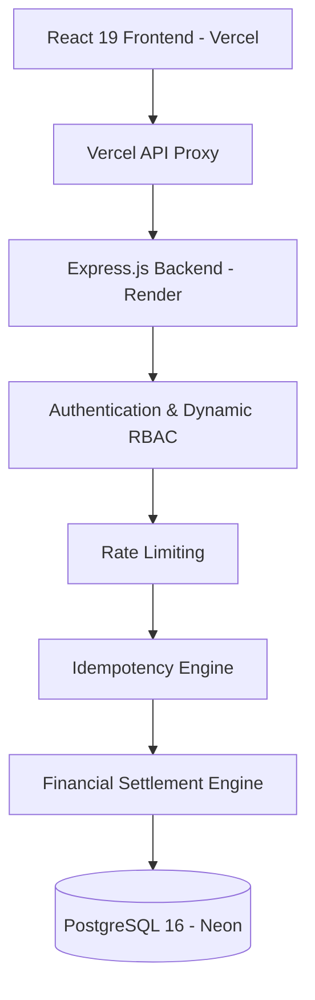
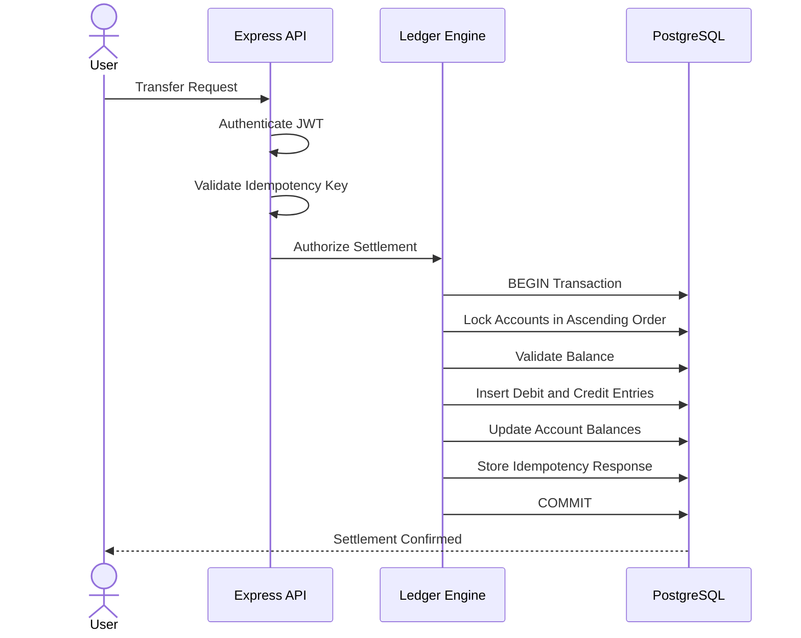
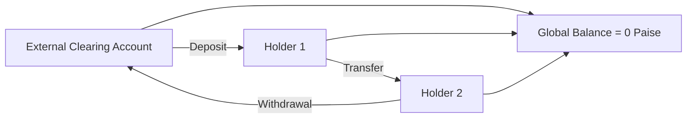
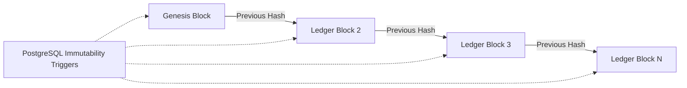

# LedgerLine — High-Integrity Financial Core & Double-Entry Ledger

[](https://github.com/rupasribakka/LedgerLine)
[](https://github.com/rupasribakka/LedgerLine)
[](https://github.com/rupasribakka/LedgerLine)
[](https://ledger-line-rupasri3.vercel.app)
[](https://ledgerline-backend-586s.onrender.com)
[](https://ledgerline-backend-586s.onrender.com/health)

> **Primary Identity:** LedgerLine  
> **Underlying Engine:** BalanceVault Financial Invariant Engine  
> **Design Personality:** Minimal Editorial Fintech × Soft Claymorphism × Purposeful Pastel Surfaces

---

## 🌐 Live Application & Resources

| Component | Provider | Status | Link |
|---|---|---|---|
| Frontend Application | Vercel | Live | [Open LedgerLine](https://ledger-line-rupasri3.vercel.app) |
| Login Portal | Vercel | Live | [Open Login](https://ledger-line-rupasri3.vercel.app/login) |
| Backend REST API | Render | Live | [Backend](https://ledgerline-backend-586s.onrender.com) |
| Health API | Render | 200 OK | [Health Check](https://ledgerline-backend-586s.onrender.com/health) |
| Source Code | GitHub | Public | [GitHub Repository](https://github.com/rupasribakka/LedgerLine) |

---

## 📌 Project Overview

LedgerLine is a high-integrity financial transaction platform built around a double-entry accounting system.

It focuses on preventing common financial data integrity problems, including:

- Race conditions and concurrent double spending.
- Floating-point precision errors in monetary calculations.
- Duplicate transactions caused by network retries.
- Unauthorized financial operations.
- Undetected modifications to historical ledger records.

The platform combines a React-based financial interface, a Node.js backend, and PostgreSQL storage to maintain consistent, auditable financial records.

Its underlying BalanceVault engine enforces financial invariants through integer-based monetary calculations, database transactions, row-level locking, idempotency protection, and cryptographic hash chaining.

## ✨ Core Features

### 1. Financial Dashboard
- Consolidated account balances.
- Account portfolio overview.
- Recent transaction activity.
- Quick access to financial operations.
- Live data retrieved from the backend.

### 2. Double-Entry Money Movement
- Account-to-account transfers.
- Deposits and withdrawals.
- Atomic financial settlements.
- Real-time balance validation.
- Equal debit and credit journal entries.

### 3. Idempotency Protection
- Unique `Idempotency-Key` for financial mutations.
- SHA-256 payload fingerprinting.
- Duplicate request detection.
- Cached responses for valid retries.
- HTTP 422 for reused keys with different payloads.

### 4. Security & Attack Lab
- Concurrent withdrawal simulation.
- Race-condition testing.
- Double-spend attack simulation.
- Duplicate request and replay testing.
- Unauthorized operation rejection.

### 5. Cryptographic Audit Ledger
- SHA-256 hash-linked ledger records.
- Parent-to-child hash continuity verification.
- Global zero-sum conservation checks.
- Append-only audit records.
- Historical transaction inspection.

### 6. Account Statements
- Individual account transaction history.
- Settled balance information.
- Ledger entry inspection.
- Expandable cryptographic proof details.

### 7. Role-Based Access Control
- Customer account access.
- Administrative operations.
- Auditor read-only access.
- Database-backed role validation.

### 8. User Interface
- Warm editorial ivory background.
- Soft claymorphic card surfaces.
- Mint, lavender, peach, powder blue, and butter accents.
- Adaptive light and dark themes.
- Responsive navigation.
- Keyboard command palette (`Ctrl + K` / `Cmd + K`).

---

## 🛡️ Financial Invariants & Security Architecture

LedgerLine enforces financial consistency at both the application and database levels.

### 1. Integer Paise Precision

All monetary calculations use integer paise instead of floating-point arithmetic.

- ₹1.00 = 100 paise.
- ₹19.99 = 1,999 paise.

This avoids IEEE-754 floating-point rounding errors during balance mutations.

### 2. Double-Entry Bookkeeping

Every financial movement generates corresponding debit and credit entries.

\[
\sum Debits = \sum Credits
\]

This ensures that each transaction remains balanced.

### 3. Global Zero-Sum Conservation

The system maintains an external clearing account.

Deposits, transfers, and withdrawals generate corresponding entries across the participating accounts.

\[
\sum AccountBalances = 0
\]

The invariant is evaluated across the complete account set, including the external account.

### 4. Deterministic Database Locking

PostgreSQL row-level locking protects concurrent financial operations.

```sql
SELECT *
FROM accounts
WHERE id IN ($1, $2)
ORDER BY id ASC
FOR UPDATE;
```

Acquiring account locks in a deterministic order helps prevent reciprocal deadlocks.

### 5. Database-Level Overdraft Protection

The database enforces a non-negative account balance constraint.

```sql
CHECK (balance_paise >= 0)
```

This prevents an account from being updated to a negative balance.

### 6. Idempotency Safeguard

Every financial mutation uses a unique idempotency key.

- Identical retries return the previously stored response.
- Reusing a key with a different payload is rejected.
- Duplicate requests cannot create additional settlements.

### 7. SHA-256 Hash Chaining

Each ledger record contains a cryptographic reference to its predecessor.

\[
H_n = SHA256(H_{n-1} \Vert CanonicalData_n)
\]

This creates a verifiable sequence of linked ledger records.

### 8. Database-Enforced Immutability

PostgreSQL triggers protect historical ledger and audit records against unauthorized modifications.

Update, delete, and truncate operations are rejected by the configured database protections.

### 9. Dynamic Role-Based Access Control

The backend validates user permissions against the active database role rather than relying exclusively on potentially stale token claims.

### 10. Database-Backed Financial Records

Account balances, transactions, and statements are retrieved from the backend database rather than generated as synthetic dashboard values.

---

## 🏗️ System Architecture

### End-to-End Architecture



### Transaction Settlement Lifecycle



### Global Zero-Sum Conservation



### Cryptographic Hash Chain



---

## 🎨 Design System

LedgerLine uses an editorial fintech design language instead of a conventional dark cybersecurity dashboard.

| Design Element | Color |
|---|---|
| Background | `#F5F1E9` |
| Primary Surface | `#FFFFFF` |
| Mint | `#DCEFE5` |
| Lavender | `#E5EAF7` |
| Peach | `#F5E2D8` |
| Powder Blue | `#DCEAF3` |
| Butter | `#F2E8C9` |
| Forest Accent | `#397A68` |
| Primary Text | `#263B35` |

The design emphasizes readability, visual hierarchy, meaningful financial indicators, and consistent interactions.

---

## 🔑 Demo Reviewer Credentials

The login portal provides preconfigured reviewer credentials for testing the different application roles.

| Role | Email | Password |
|---|---|---|
| Holder 1 | `holder1@ledgerline.local` | `Holder1Password123!` |
| Holder 2 | `holder2@ledgerline.local` | `Holder2Password123!` |
| Admin | `admin@ledgerline.local` | `AdminPassword123!` |
| Auditor | `auditor@ledgerline.local` | `AuditorPassword123!` |

**Access permissions:**

- **Holder:** Account statements and permitted financial transactions.
- **Admin:** Administrative account operations and system management.
- **Auditor:** Read-only compliance and ledger inspection.

These are demonstration credentials. Do not use them for real financial data or production accounts.

---

## 💻 Technology Stack

| Layer | Technologies |
|---|---|
| Frontend | React 19, Vite 8 |
| Styling | Tailwind CSS 4 |
| UI & Animation | Lucide React, Framer Motion |
| Backend | Node.js, Express.js |
| Database | PostgreSQL 16, Neon |
| Authentication | JWT, bcryptjs |
| Cryptography | SHA-256 |
| Financial Logic | Integer Paise, BigInt |
| Security | RBAC, Rate Limiting, Idempotency |
| Deployment | Vercel, Render |
| Testing | Vitest, Supertest, Automated Attack Tests |
| Development | Git, GitHub, VS Code, Postman |

---

## 📂 Application Routes

### Public Pages

| Route | Description |
|---|---|
| `/` | Landing page and project overview |
| `/login` | Authentication and reviewer login |
| `/signup` | User registration |

### Protected Application

| Route | Description |
|---|---|
| `/app` | Financial dashboard |
| `/app/accounts` | Account portfolio |
| `/app/accounts/:id` | Individual account statement |
| `/app/move` | Transfer, deposit, and withdrawal |
| `/app/transactions` | Transaction history |
| `/app/audit` | Cryptographic audit console |
| `/app/admin` | Administrative console |
| `/app/attack-lab` | Security and concurrency testing |

---

## 🧪 Automated Testing

LedgerLine includes automated tests covering financial invariants, transaction integrity, and security scenarios.

### Test Commands

```bash
# Run unit and integration tests
npm test

# Run concurrency and double-spend attack tests
npm run attack

# Run mutation testing
npm run mutation

# Build the frontend
npm --prefix client run build

# Run frontend linting
npm --prefix client run lint
```

### Verified Test Results

| Test Category | Result |
|---|---|
| Financial and integration tests | 36/36 passed |
| Mutation testing | 6/6 killed |
| Automated attack scenarios | 7/7 passed |

The attack suite covers concurrent withdrawals, repeated requests, altered idempotency payloads, unauthorized operations, and ledger verification.

---

## ⚙️ Local Installation & Setup

### Prerequisites

- Node.js 20+
- npm
- PostgreSQL database
- Git

### 1. Clone the Repository

```bash
git clone https://github.com/rupasribakka/LedgerLine.git

cd LedgerLine
```

### 2. Install Dependencies

```bash
npm install
```

### 3. Configure Environment Variables

Create the required environment configuration using the project's environment example.

Configure the database connection, JWT secret, and migration database credentials.

### 4. Run Database Migrations

```bash
npm run migrate
npm run seed
```

### 5. Start the Backend

```bash
npm run dev
```

Backend runs at:

`http://localhost:5000`

### 6. Start the Frontend

Open another terminal:

```bash
cd client

npm install

npm run dev
```

Frontend runs at:

`http://localhost:5173`

---

## 🤖 AI-Assisted Development

AI tools were used as development assistants for architecture exploration, implementation support, debugging, and testing.

| Tool | Usage |
|---|---|
| Antigravity (Google) | Full-stack implementation assistance, UI development, debugging, and browser testing |
| ChatGPT | Double-entry accounting concepts, financial invariants, security review, and implementation guidance |
| Claude | Mathematical modeling and cryptographic hash-chain concepts |

All generated implementations were subject to inspection, corrections, and testing during development.

### Engineering Decisions & Corrections

Several implementation issues were identified and corrected during development:

**1. Frontend Runtime Error**

An undeclared `useNavigate` hook caused a production blank-screen issue. The unused hook was removed, and the application was rebuilt and redeployed.

**2. Floating-Point Precision**

Floating-point calculations were replaced with integer paise arithmetic for financial balance mutations.

**3. Concurrency Protection**

Application-level in-memory locking was replaced with PostgreSQL row-level locking to support concurrent operations across application instances.

**4. Interface Design**

A generic dark cybersecurity dashboard was replaced with a warm editorial fintech design system focused on financial clarity and usability.

---

## 🚧 Limitations & Future Enhancements

The following capabilities are outside the current implementation scope:

1. **WebSocket / SSE Integration:** Real-time updates currently rely on application state updates and polling rather than persistent push connections.
2. **HSM / Cloud KMS Integration:** Dedicated hardware-backed key management and automated key rotation are future enhancements.
3. **Multi-Currency Conversion:** Native financial calculations currently use INR paise; dynamic cross-border FX conversion is not implemented.
4. **Production Infrastructure:** The backend uses Render's free tier, so the first request after inactivity may experience a cold-start delay.

---

## 📜 License

This project is available under the MIT License.

See the [LICENSE](LICENSE) file for details.

---

## 👩‍💻 Author

**Bakka Rupasri**

B.Tech Computer Science and Engineering  
VVIT — Vasireddy Venkatadri Institute of Technology

GitHub: [@rupasribakka](https://github.com/rupasribakka)

---

**LedgerLine — Every transaction balanced. Every movement traceable. Every record verifiable.**
