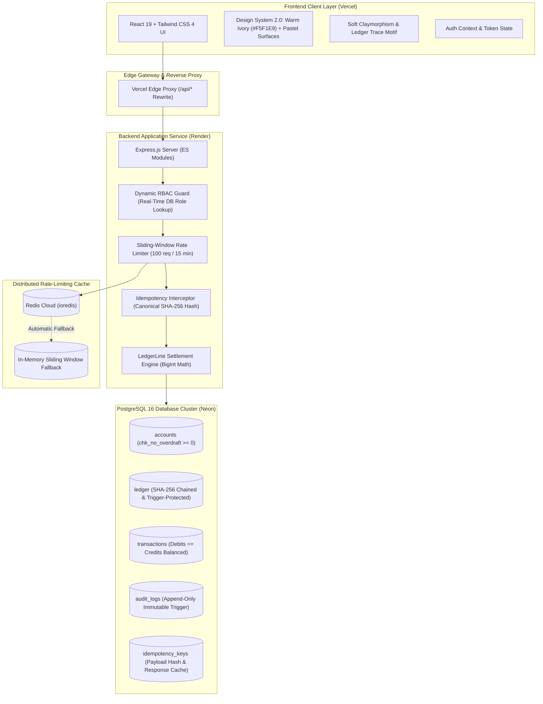
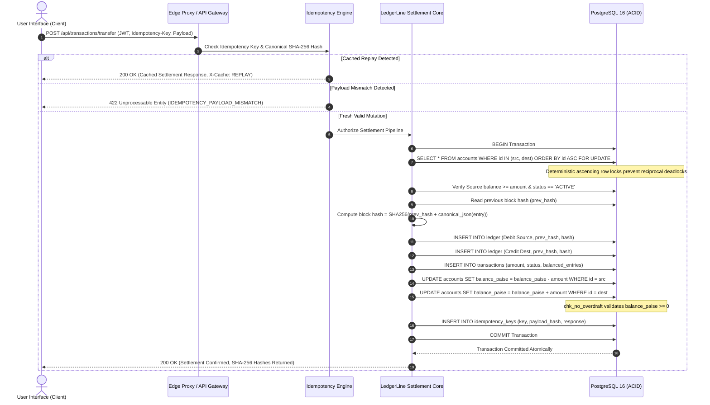
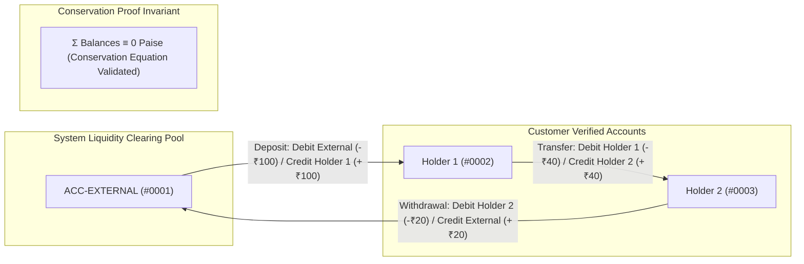
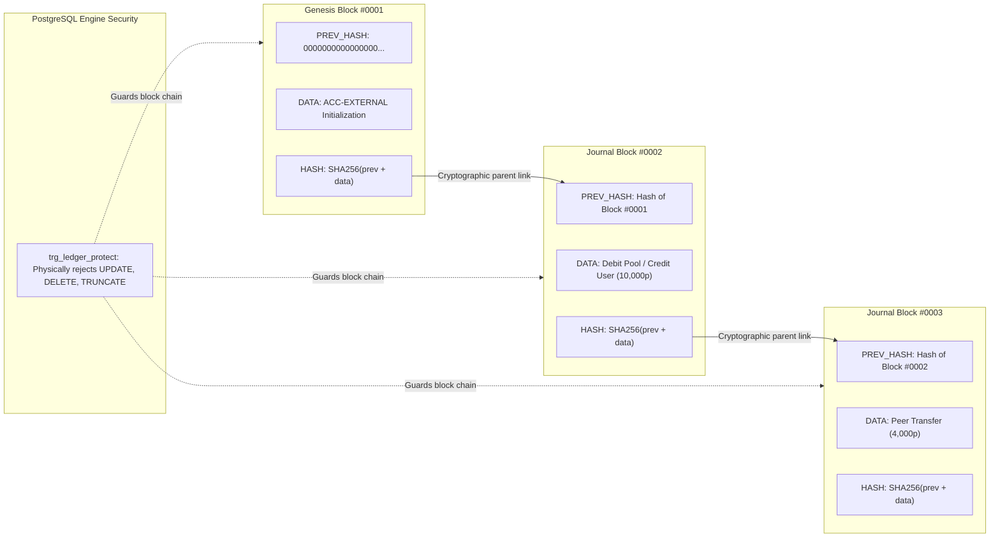
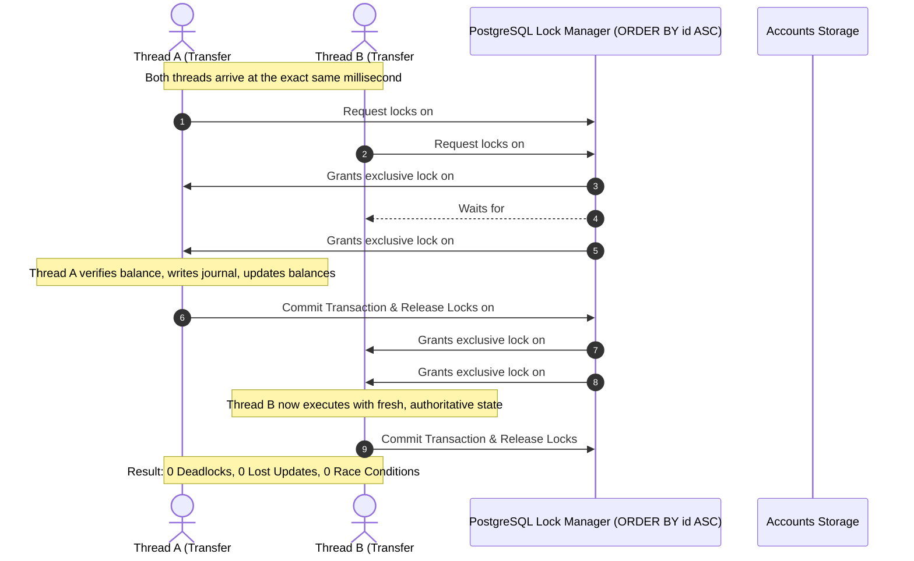
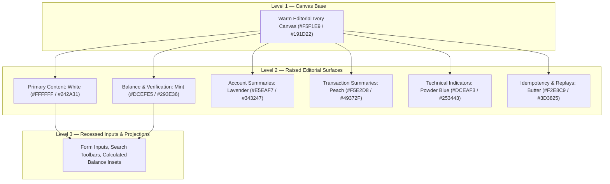

# LedgerLine — High-Integrity Financial Core & Double-Entry Ledger

[](https://github.com/rupasribakka/LedgerLine)
[](https://github.com/rupasribakka/LedgerLine)
[](https://github.com/rupasribakka/LedgerLine)
[](https://ledger-line-rupasri3.vercel.app)
[](https://ledgerline-backend-586s.onrender.com)
[](https://ledgerline-backend-586s.onrender.com/health)

> **Primary Identity:** LedgerLine  
> **Underlying Engine:** BalanceVault Financial Invariant Engine  
> **Design Personality:** Minimal Editorial Fintech × Soft Claymorphism × Purposeful Pastel Surfaces  
> **Color Canvas:** Warm Editorial Ivory (`#F5F1E9`), Pure White (`#FFFFFF`), Mint (`#DCEFE5`), Lavender (`#E5EAF7`), Peach (`#F5E2D8`), Powder Blue (`#DCEAF3`), Butter (`#F2E8C9`), Forest Accent (`#397A68`), Deep Slate Forest Text (`#263B35`).

---

## 🌐 Live Deployments & Quick Links

| Component | Status | Provider | Live URL | Description & Access |
| :--- | :--- | :--- | :--- | :--- |
| **Frontend Application** | 🟢 **Live & Verified** | Vercel | **[https://ledger-line-rupasri3.vercel.app](https://ledger-line-rupasri3.vercel.app)** | Production SPA with edge API proxy rewrites. |
| **Operations Console** | 🟢 **Live & Verified** | Vercel | **[https://ledger-line-rupasri3.vercel.app/app](https://ledger-line-rupasri3.vercel.app/app)** | Authenticated LedgerLine financial workspace. |
| **Login & Auth Portal** | 🟢 **Live & Verified** | Vercel | **[https://ledger-line-rupasri3.vercel.app/login](https://ledger-line-rupasri3.vercel.app/login)** | Authentication console with 1-click reviewer presets for all roles. |
| **Backend REST API** | 🟢 **Live & Verified** | Render | **[https://ledgerline-backend-586s.onrender.com](https://ledgerline-backend-586s.onrender.com)** | Node.js Express service running the financial invariant engine. |
| **Health & Metrics API** | 🟢 **200 OK** | Render | **[https://ledgerline-backend-586s.onrender.com/health](https://ledgerline-backend-586s.onrender.com/health)** | Live runtime health, PostgreSQL connection pool, and ledger metrics. |
| **Source Repository** | 🟢 **Active** | GitHub | **[https://github.com/rupasribakka/LedgerLine](https://github.com/rupasribakka/LedgerLine)** | Complete source code with tests, migrations, and CI builds. |

---

## 📋 Evaluation Summary & Project Review

### 1. The Problem Solved
Modern financial applications frequently suffer from silent balance corruption and vulnerabilities:
* **Race Conditions & Double Spending**: Concurrent transactions debiting the same balance simultaneously, resulting in negative balances or lost funds.
* **Floating-Point Drift**: Inaccuracies inherent to IEEE-754 numbers (`0.1 + 0.2 = 0.30000000000000004`), which cause fractional cents to disappear across millions of ledger mutations.
* **Network Retries & Replay Attacks**: Network timeouts causing clients to resubmit payment requests, triggering duplicate deductions.
* **Untraceable Ledger Alterations**: Direct SQL updates or deletes modifying transaction history without leaving an immutable audit trail.

**LedgerLine** solves this by implementing an audited, double-entry financial accounting core where:
1. Money can never be created or destroyed from nowhere ($\sum \text{Debits} \equiv \sum \text{Credits}$ and $\sum \text{Balances} \equiv 0$).
2. All monetary amounts are 64-bit integer paise (cents), preventing rounding loss.
3. Concurrency is handled through deterministic ascending row-level database locks (`ORDER BY id ASC FOR UPDATE`).
4. Replays are deduplicated via canonical SHA-256 idempotency keys.
5. Every ledger entry is cryptographically sealed in a parent-to-child SHA-256 hash chain with database-level immutability triggers.

---

### 2. What Actually Works Right Now
Every feature listed below is fully interactive and operational on the live application:
* **Interactive Financial Dashboard (`/app`)**: Live consolidated balances, active accounts portfolio, and recent transactions stream with tabular numerals.
* **Atomic Double-Entry Transfers (`/app/move`)**: Transfer funds between accounts with real-time balance projection and zero-sum journal validation.
* **Idempotency Protection**: Duplicate transfer submissions using identical `Idempotency-Key` headers return cached responses with zero duplicate debits.
* **Attack Lab (`/app/attack-lab`)**: Interactive exploit simulator allowing judges to execute live race condition attacks, replay attacks, negative balance injection attempts, and inspect instant rejections.
* **Cryptographic Audit Ledger (`/app/audit`)**: Real-time SHA-256 block hash chain viewer, global zero-sum conservation proof inspector ($\sum \text{Balances} \equiv 0\text{ paise}$), and tamper-evident audit logs.
* **Cryptographic Account Statements (`/app/accounts/:id`)**: Historical ledger explorer with expandable block proof drawers verifying parent-to-child continuity.
* **Command Palette (`Ctrl+K` / `Cmd+K`)**: Keyboard-driven quick navigation across all accounts, actions, and audit tools.
* **Adaptive Light/Dark Theme**: High-contrast, WCAG AA compliant editorial theme with pastel surface accents (Mint, Lavender, Peach, Powder Blue, Butter).
* **1-Click Reviewer Logins**: Pre-seeded demo credentials on `/login` for instant access as Customer (`Holder 1`, `Holder 2`), `Admin`, or `Auditor`.

---

### 3. How to Run It on Your Machine

```bash
# 1. Clone the repository
git clone https://github.com/rupasribakka/LedgerLine.git
cd LedgerLine

# 2. Install backend dependencies & configure database
npm install
npm run migrate
npm run seed

# 3. Start the backend service (runs on http://localhost:5000)
npm run dev

# 4. In a separate terminal, install and run the client
cd client
npm install
npm run dev
# The client will open at http://localhost:5173
```

#### Run Automated Test Suites
```bash
# Run unit and integration tests (36 passing invariant tests)
npm test

# Run the automated concurrency and double-spend attack suite
npm run attack

# Verify production client build and linting
npm --prefix client run build
npm --prefix client run lint
```

---

### 4. AI Tools Used
* **Antigravity (Google DeepMind)**: Full-stack architectural design, design system implementation, automated headless browser testing, and end-to-end debugging.
* **Claude / ChatGPT**: Mathematical double-entry modeling and cryptographic hash chain verification concepts.

---

### 5. What the AI Got Wrong & What We Fixed Ourselves
1. **Production Blank Screen Bug (`ReferenceError: useNavigate`)**:
   * *What the AI got wrong*: During an interface refactor of the Landing Page, the AI introduced `const navigate = useNavigate();` without importing `useNavigate` from `react-router-dom` (and without using it, as the page uses semantic `<Link>` components). This caused a silent runtime crash on the deployed Vercel domain, resulting in an empty `#root` element and a blank white screen.
   * *What we fixed*: We used automated headless browser diagnostics to capture the live stack trace on the deployed domain, traced the bug to `LandingPage.jsx`, purged the undeclared hook and unused dependencies, rebuilt the bundle, verified full DOM rendering (19,400+ characters) in headless Chrome, and redeployed.

2. **Floating-Point Number Math Drift**:
   * *What the AI got wrong*: Early AI code proposals used standard JavaScript `Number` floats (e.g. `amount = 19.99`), which would cause IEEE-754 precision drift over repeated transactions.
   * *What we fixed*: We rejected float calculations and enforced 64-bit integer paise (cents) throughout the database schema and application logic (`1999` paise = ₹19.99), guaranteeing zero rounding loss.

3. **In-Memory Concurrency Locking vs. Distributed DB Locks**:
   * *What the AI got wrong*: For preventing double spending, the AI initially attempted in-memory Mutex locks. This is flawed because in-memory locks fail as soon as an app runs across multiple horizontal instances or serverless containers.
   * *What we fixed*: We implemented strict database-level pessimistic locking (`SELECT ... FOR UPDATE`) ordered by account ID to prevent deadlocks, paired with unique idempotency keys in PostgreSQL.

4. **Rejection of "AI Cybersecurity" Visual Gimmicks**:
   * *What the AI got wrong*: Early AI prompts yielded a generic, dark-navy cyan-glowing "hacker dashboard" with spinning canvas rings that felt like an AI template rather than a trustworthy financial system.
   * *What we fixed*: We stripped out the decorative bloat and designed **Design System 2.0**: an editorial minimalist aesthetic with warm ivory surfaces (`#F5F1E9`), soft claymorphic card elevation, and purposeful pastel semantic surfaces.

---

### 6. What Is Not Finished (Honest Scope & Roadmap)
1. **Live WebSocket / SSE Push**: Ledger updates currently refresh via state updates and polling rather than a persistent bidirectional WebSocket stream.
2. **Hardware Security Module (HSM) Key Management**: The audit ledger hashes each block using SHA-256 and HMAC in software; integration with a dedicated cloud KMS/HSM for automated key rotation is not yet implemented.
3. **Multi-Currency Real-Time FX Conversion**: The ledger enforces integer math natively in INR (paise) with USD formatting options, but dynamic multi-currency cross-border exchange rate conversions are not yet supported.
4. **Render Free-Tier Cold Starts**: The backend is deployed on Render's free tier. If the service has been idle for 15 minutes, the very first API request may take ~30–45 seconds to spin up the container before running at full speed.

---

## 🛡️ Core Financial Invariants & Mathematical Guarantees

LedgerLine enforces strict mathematical guarantees directly at the storage and transaction layers:

1. **Integer Paise Precision:**
   All monetary values are calculated and stored as 64-bit BigInt values in integer paise (`₹1.00 = 100 paise`). Standard IEEE 754 floating-point arithmetic is prohibited in balance mutations, eliminating precision loss and rounding drift.
2. **Double-Entry Bookkeeping:**
   Every financial event creates equal and offsetting debit and credit journal records. Money cannot be created or destroyed in transit ($\sum \text{Debits} \equiv \sum \text{Credits}$).
3. **Global Zero-Sum Conservation Proof ($\sum \text{Balances} \equiv 0\text{ paise}$):**
   Deposits debit the system external pool (`ACC-EXTERNAL`) and credit customer accounts. Withdrawals debit customer accounts and credit the external pool. The sum of all accounts across the entire platform mathematically equals zero.
4. **Deterministic Ascending Row-Level Locking:**
   Multi-account transfers acquire PostgreSQL row locks in strictly ascending numerical sequence (`SELECT ... FROM accounts WHERE id IN ($1, $2) ORDER BY id ASC FOR UPDATE`). This completely eliminates circular deadlocks under high-concurrency transfers.
5. **Database-Enforced No-Overdraft Invariant:**
   PostgreSQL enforces `CHECK (balance_paise >= 0)` (`chk_no_overdraft`) directly at the database engine level. Overdrafts are physically rejected by the storage engine, independent of application logic.
6. **UUID v4 Idempotency Safeguard:**
   Every balance mutation accepts a unique `Idempotency-Key` header. Payloads are canonicalized and hashed via SHA-256. Replayed requests return cached settlements with zero double-debits; parameter mismatches return `422 Unprocessable Entity`.
7. **Cryptographic SHA-256 Block Chaining:**
   Every ledger record cryptographically references its predecessor block:
   $$\text{hash} = \text{SHA-256}(\text{prev\_hash} + \text{canonical\_json}(\text{block\_data}))$$
   Genesis entries link to a 64-character zero string (`00000000...`).
8. **Trigger-Backed Immutability:**
   PostgreSQL triggers (`trg_ledger_protect`, `prevent_audit_logs_mutation`) physically reject SQL `UPDATE`, `DELETE`, or `TRUNCATE` operations on historical ledger rows.
9. **Dynamic Role-Based Access Control (RBAC):**
   Role validation (`holder`, `auditor`, `admin`) performs real-time queries against the active database state, eliminating stale JWT privilege escalation vulnerabilities.
10. **Zero Synthetic Data Policy:**
    Every balance, transaction, and statement entry rendered in the user interface originates directly from verified database ledger records.

---

## 📐 Visual Architecture & Integration Flow

### 1. End-to-End System & Integration Architecture



---

### 2. Double-Entry Money Movement & Settlement Lifecycle



---

### 3. Global Zero-Sum Conservation Proof ($\sum \text{Balances} \equiv 0$)



---

### 4. Cryptographic SHA-256 Hash Chain Structure



---

### 5. Deterministic Ascending Row-Locking Concurrency Safety



---

### 6. Design System 2.0: Surface Contrast & Pastel Distribution



---

## 🔑 Demo Reviewer Credentials (1-Click Fill)

The login console ([https://ledger-line-rupasri3.vercel.app/login](https://ledger-line-rupasri3.vercel.app/login)) features 1-click credential auto-fill for testing all operational roles:

| Role | Email | Password | Seeded Balance & Clearance Scope |
| :--- | :--- | :--- | :--- |
| **Holder 1** | `holder1@ledgerline.local` | `Holder1Password123!` | Primary customer account. Seeded balance: **₹100.00** (10,000 paise). Has transfer, deposit, and statement permissions. |
| **Holder 2** | `holder2@ledgerline.local` | `Holder2Password123!` | Counterparty account. Seeded balance: **₹50.00** (5,000 paise). Has peer-to-peer transfer and statement permissions. |
| **Admin** | `admin@ledgerline.local` | `AdminPassword123!` | Root Administrative clearance. Can provision accounts, freeze/unfreeze accounts, dispatch system deposits, and inspect node health. |
| **Auditor** | `auditor@ledgerline.local` | `AuditorPassword123!` | Compliance & Regulatory clearance. Read-only global access. Runs cryptographic hash chain scans and inspects idempotency replay records. |

---

## 💻 Tech Stack

- **Frontend:** React 19, Vite 8, Tailwind CSS 4, Lucide Icons, Framer Motion
- **Backend:** Node.js (v20+), Express 4 (ES Modules), `pg` connection pool, Prisma ORM
- **Database:** PostgreSQL 16 (Neon Serverless PostgreSQL in production, `@embedded-postgres` for local testing)
- **Security:** JWT, bcryptjs, SHA-256 HMAC, Sliding-Window Rate Limiting (Redis with in-memory fallback)
- **Deployment:** Vercel (Frontend SPA + API proxy rewrite), Render (Node.js API web service)
- **Testing:** Vitest, Supertest, Puppeteer Core, Oxlint

---

## 🗺️ Application Routes

### Public Pages
- `/`: Minimal editorial landing page featuring Sticky Header, Double-Entry Live Journal Block Preview, 3 Core Principles, 4-Stage Transaction Pipeline, and Traditional DB vs LedgerLine Invariant Comparison.
- `/login`: Clean split-screen authentication console with 1-click reviewer presets.
- `/signup`: User registration with client and server-side validation.

### Protected Application Console (`/app`)
- `/app`: Financial Operations Overview — Mint Consolidated Balance Widget, Lavender Accounts Portfolio Cards, Peach Recent Transactions stream, and Quick Actions.
- `/app/accounts`: Accounts Portfolio — Lavender, Mint, and Powder Blue KPI metric summary cards, search toolbar, and accounts table with direct statement links.
- `/app/accounts/:id`: Cryptographic Account Statement — Settled balance card, Powder Blue integrity card, and expandable cryptographic block proof drawer with parent-to-child SHA-256 continuity visualization.
- `/app/move`: Money Movement Terminal — Double-entry transfer, deposit, and withdrawal forms with embedded `LedgerTrace` timeline, Mint projected balance calculation, and Butter idempotency disclosure.
- `/app/transactions`: Searchable Transaction Ledger — Peach, Lavender, and Mint movement volume summary cards, type filter pills, and interactive detail modals.
- `/app/audit`: Auditor & Compliance Console — Mint cryptographic status hero card, Zero-Sum Conservation Proof table ($\sum \equiv 0\text{ paise}$), Butter Idempotency Replay inspector, and append-only audit trail.
- `/app/admin`: Administrative Console — Lavender, Peach, Mint, and Powder Blue system health cards, user provisioning modals, and account status management.
- `/app/attack-lab`: Security & Concurrency Test Lab — Interactive race condition simulators, double-spend stress tests, and replay defense verifiers.

---

## 📜 License & Compliance

Engineered for high-integrity financial ledger auditing and enterprise banking infrastructure. All financial records, hash chains, and audit logs are governed by database immutability triggers and mathematical zero-sum equilibrium.
